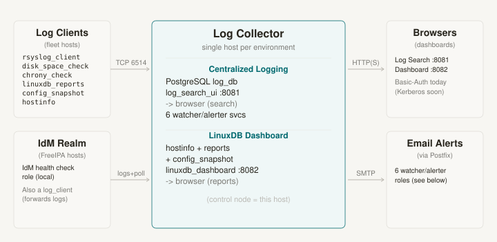
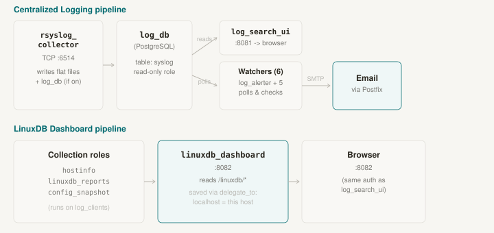
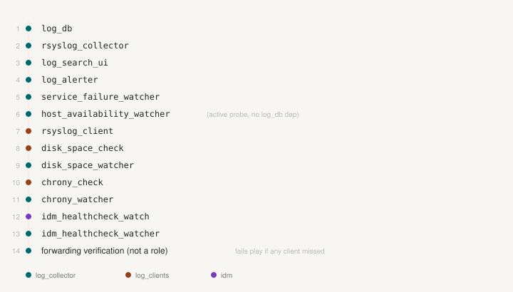
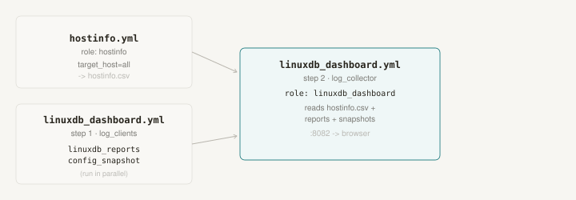

# ansible_operations — Architecture Diagrams

Visual reference for how the repo's roles and playbooks fit together: which
hosts talk to which services, and which playbook orchestrates which roles in
what order. These are a companion to the root `README.md` and the per-role
`README.md` files — start here for the big picture, then drill into a role's
own README for variables and setup steps.

## 1. System overview

Five zones: **Log Clients** (the fleet), the **IdM Realm**, the **Log
Collector** (a single host per environment that runs both pipelines below),
**Browsers**, and **Email Alerts**. Log clients forward syslog over TCP 6514
and are polled/checked by the collector; the collector serves both dashboards
over HTTP(S) and sends alerts by SMTP through the local Postfix relay.

## 2. Inside the Log Collector — the two pipelines

- **Centralized Logging** — `rsyslog_collector` (TCP :6514) writes flat files
  and, when enabled, rows into the local PostgreSQL `log_db`. `log_search_ui`
  (:8081) reads `log_db` for search; six watcher/alerter roles poll `log_db`
  or actively probe hosts and email through Postfix.
- **LinuxDB Dashboard** — `hostinfo`, `linuxdb_reports`, and `config_snapshot`
  run against every log client but write back with `delegate_to: localhost`,
  landing under `/linuxdb/...` on the collector itself (the Ansible control
  node effectively *is* the collector host in this PoC). `linuxdb_dashboard`
  (:8082) reads those files directly — no database involved.

## 3. `playbooks/centralized_logging.yml` — role execution order

The 14-step play order, colored by target inventory group (teal =
`log_collector`, amber = `log_clients`, purple = `idm`). Core services stand up
first, then the collector-side watchers, then the client-side checks
interleaved with their matching watchers, then the IdM health-check pair, and
finally a forwarding-verification play that fails the run if any client's logs
didn't make it into `log_db`.

## 4. `playbooks/linuxdb_dashboard.yml` & `playbooks/hostinfo.yml` — role orchestration

`hostinfo.yml` runs the `hostinfo` role once (`target_host` prompt, defaults to
`all`) and writes `hostinfo.csv`. `linuxdb_dashboard.yml` runs
`linuxdb_reports` and `config_snapshot` on `log_clients` in parallel, then the
`linuxdb_dashboard` role on `log_collector`, which reads all three data
sources to serve port 8082.

## Utility / ad-hoc playbooks (not part of either pipeline)

| Playbook | Role(s) invoked | Runs against |
|---|---|---|
| `idm_healthcheck.yml` | `idm_healthchecks` | `idm` |
| `service_failure_alert.yml` | *(retired — logic moved into `service_failure_watcher`)* | — |
| `system_update.yml` / `update_system.yml` | patch/update tasks (no dedicated role) | `target_hosts` var |
| `system_poweroff.yml` | `system_poweroff` | any, iLO/IPMI-aware |
| `poweroff_all.yml` | inline tasks (no role) | any group, plain SSH shutdown |
| `silence_setroubleshoot.yml` | inline tasks (no role) | non-prod PoC hosts only |
| `sudo_audit_report.yml` | inline tasks (no role) | `all` (or `--limit`) |
| `dnf_history.yml` | inline tasks (no role) | `target_host` var |
| `gather_critical_alerts.yml` | inline tasks (no role) | `target_host` var (prompted) |
| `collect_ilo.yml` | inline tasks (no role) | `[hpe_ilo_hosts]` |
| `deploy_timesync_role.yml` | inline tasks (no role) | `target_host` var (prompted) |
| `idm_copy_gssapi_delegation.yml` | inline tasks (no role) | `target_host` var |
| `push_script_and_run.yml` | inline tasks (no role) | `target_host` var |
| `lineage.yml` | inline tasks (no role) | any managed host |

Most of these are single-purpose plays with inline tasks rather than dedicated
roles — only the ones feeding the two continuous pipelines, plus
`system_poweroff` and `idm_healthchecks`, are structured as reusable roles.
