# Log Search UI & LinuxDB Dashboard — Screenshots

These screenshots were captured from the two web dashboards this repo
deploys (`roles/log_search_ui` and `roles/linuxdb_dashboard`), running
against a 5-host home lab (`admin1`, `aap1`, `client1`, `idm1`, `nfs1`
— all RHEL 10.2). They're included here as a "what we're going to
build" reference for the work rollout: same roles, same playbooks,
pointed at the work fleet instead of the lab.

Both apps follow the same build philosophy used throughout this repo:
pure Python standard library (`wsgiref.simple_server`, no Flask, no
httpd/mod_wsgi), packaged only from RHEL BaseOS/AppStream (`log_search_ui`
additionally uses `python3-psycopg2` to talk to the Postgres-backed
`log_db`), running as an unprivileged systemd service, compatible with
both RHEL 8's older Python 3.6 and RHEL 10's Python — see each role's
own `README.md` for full detail (`roles/log_search_ui/README.md`,
`roles/linuxdb_dashboard/README.md`).

## Authentication

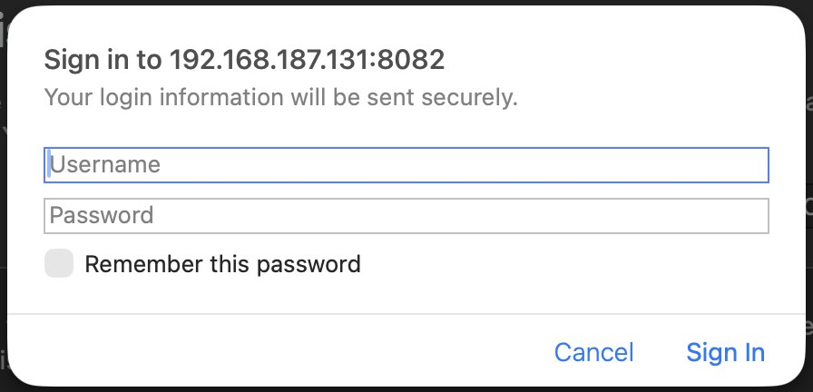

Both dashboards sit behind a login before any data is shown — this is
the browser's native sign-in prompt guarding `localhost:8082`
(LinuxDB). For the work rollout this is where the Kerberos/AD-backed
dashboard authentication (see the separate Kerberos Dashboard Auth
rollout notes) plugs in, so access is tied to each engineer's existing
domain identity rather than a locally-managed password.

## Log Search UI (`roles/log_search_ui`)

Searches the centralized `log_db` (fed by the rsyslog + journald
pipeline documented in the main rollout guide) instead of grepping
flat files across the fleet.

### Search

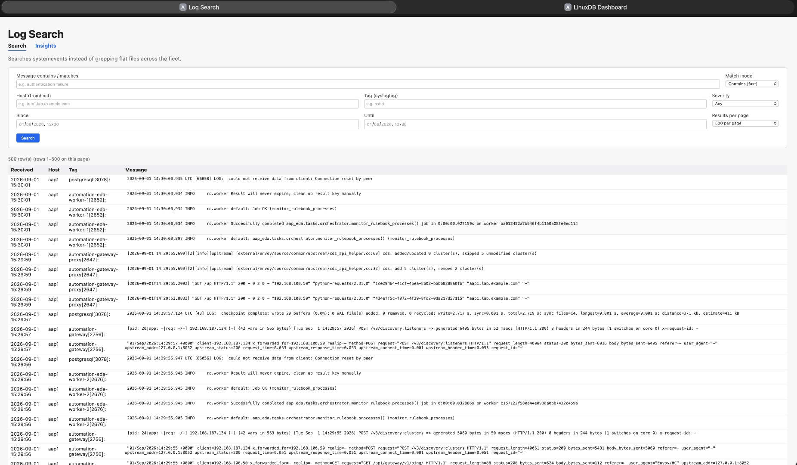

The main search screen: filter by message text (substring or POSIX
regex), host, syslog tag, severity, and a since/until time window,
with pagination (500/1000/2000/5000/All results per page). The example
shown is an unfiltered pull of the most recent 500 rows across the
fleet — in normal use this is where you'd narrow down to, say,
`sshd` + `Failed password` + a specific host, in seconds, instead of
SSHing to each box.

### Insights

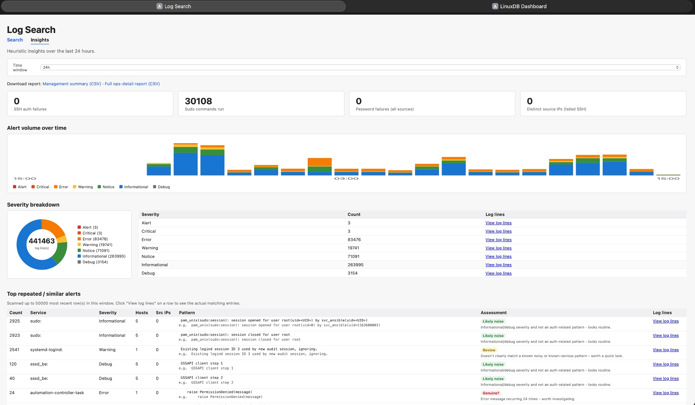

A heuristics dashboard over a selectable time window (24h shown here):

- **Headline counters** — SSH auth failures, sudo commands run,
  password failures across all sources, distinct source IPs behind
  failed SSH attempts.
- **Alert volume over time** — a stacked, severity-coloured bar chart
  (Alert/Critical/Error/Warning/Notice/Informational/Debug) so spikes
  are visible at a glance rather than buried in raw text.
- **Severity breakdown** — a donut chart plus table (441,463 total log
  lines in this 24h lab window, split by severity), each row linking
  straight through to the matching raw log lines.
- **Top repeated / similar alerts** — pattern-clusters the noisiest
  recurring log lines (e.g. routine sudo session open/close, SSSD
  GSSAPI negotiation) and flags each cluster as "Likely noise" or
  "Review" / "Genuine?" — in the lab run pictured, one cluster
  (`automation-controller-task` raising `PermissionDenied` 24 times)
  was flagged **Genuine? — worth investigating**, which is exactly the
  kind of needle-in-haystack signal this view is meant to surface.
- **CSV exports** — a management summary and a full ops-detail report,
  for sharing outside the dashboard itself.

## LinuxDB Dashboard (`roles/linuxdb_dashboard`)

A read-only fleet inventory and per-host diagnostic browser, built on
top of `roles/hostinfo` (the fleet-wide `hostinfo.csv`) and
`roles/linuxdb_reports` (timestamped per-host diagnostic snapshots).

### Fleet overview

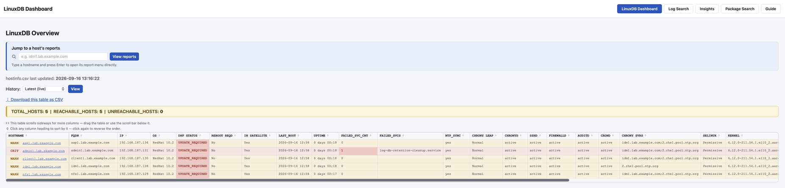

One table, one page: every host's hostname/FQDN/IP, OS version, patch
status (`DNF_STATUS`), whether a reboot is required, Satellite
membership, last boot time and uptime, failed-service count, NTP sync
state, and SELinux enforcement mode. A "History" selector lets you
step back to a previous captured run instead of only ever seeing
"latest live" — useful for before/after comparisons around a patch
window.

### Per-host drill-down

Clicking a hostname opens seven tabs of detail for that host, all
sourced from the same timestamped `linuxdb_reports` run (run ID shown
and independently selectable per tab, e.g. `20260901_134912`):

**Overview** — 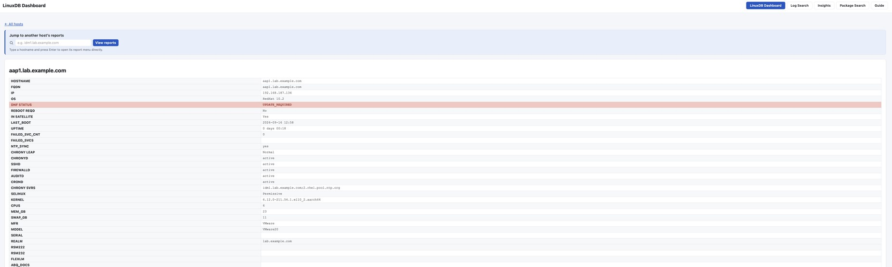
Identity and baseline facts: hostname/FQDN/IP, OS/kernel version,
patch and reboot status, Satellite membership, uptime, failed service
count, NTP/chrony sync state and source, SELinux mode, CPU/memory/swap
sizing, hypervisor make/model, IPA realm, and placeholder fields for
site-specific inventory systems (RSM, FlexLM licensing, etc.) —
these blank columns are exactly where work-specific inventory fields
would get wired in.

**Disk & Filesystem** — 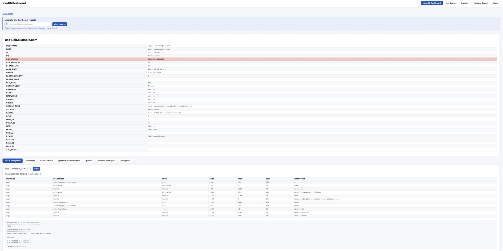
Every mounted filesystem (type, size, used, use%, mountpoint), plus an
automated filesystem-utilisation warning check and an fstab-vs-mounted
validation pass (`STATUS|PASS|Mounted filesystems match fstab`) — this
is a fast way to catch a filesystem nearing capacity or an fstab entry
that silently didn't mount, without logging into the host.

**Processes** — 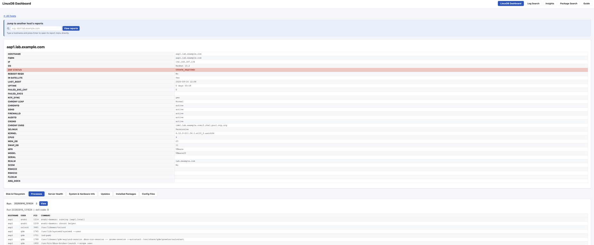
The full process table (host, user, PID, command) plus a summary
block: total process/user counts and top-CPU / top-memory consumers.
Useful as a first stop when a host is reported slow or when confirming
what's actually running on an unfamiliar box before making a change.

**Server Health** — 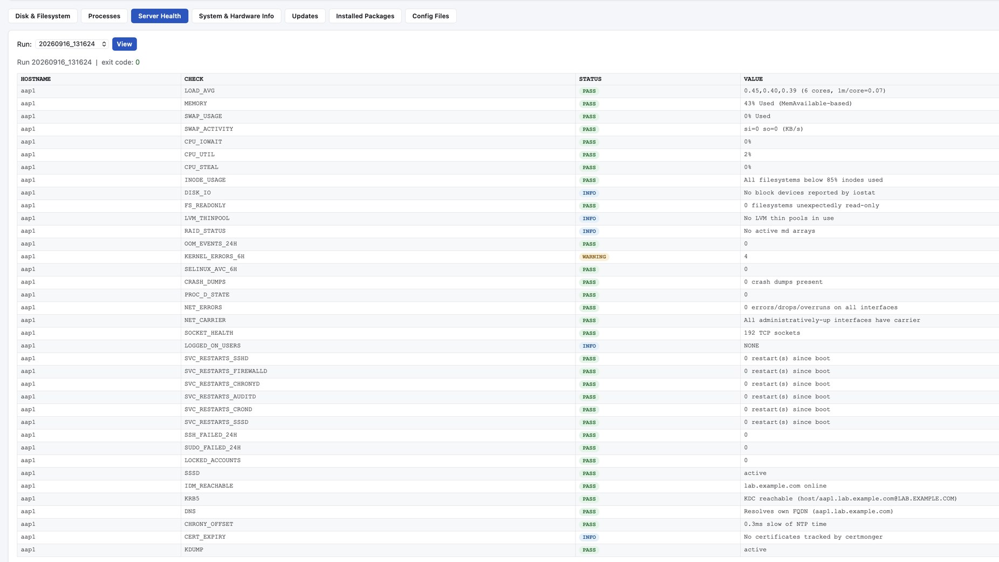
A checklist-style health rollup: load average, memory/swap usage, CPU
iowait, inode usage, failed systemd services, key service state
(`sshd`, `firewalld`, `chronyd`, `auditd`, `crond`), OOM events and
kernel errors in the recent window, D-state processes, network
errors, logged-on users, failed SSH/sudo attempts and locked accounts,
SSSD/IdM/KRB5/DNS reachability, and **certificate expiry tracking**
for every IPA/PKI certificate on the host (each with a PASS/days-left
readout) — this last part is the same "don't get surprised by an
expired cert" concern that motivated the rsyslog TLS work and the
dashboard's own TLS certs.

**System & Hardware Info** — 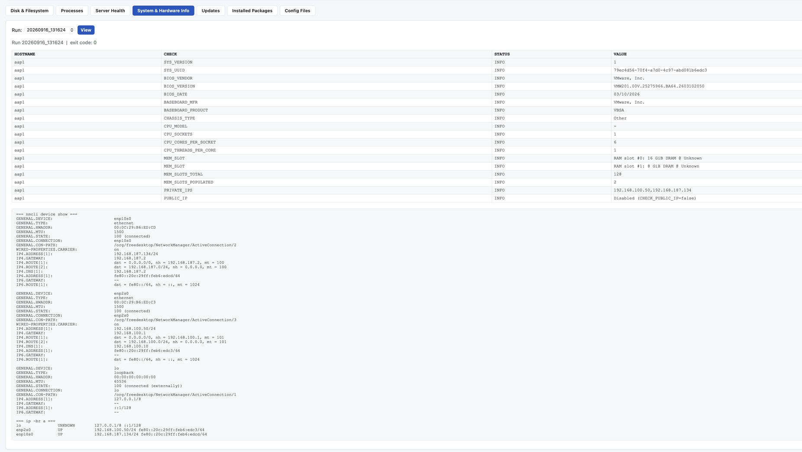
Lower-level facts that rarely change day to day but matter for
capacity planning and asset tracking: BIOS vendor/version/date,
baseboard manufacturer/product, chassis type, CPU model/socket/core/
thread counts, memory slot population, and both private and public IP
addresses.

**Updates** — 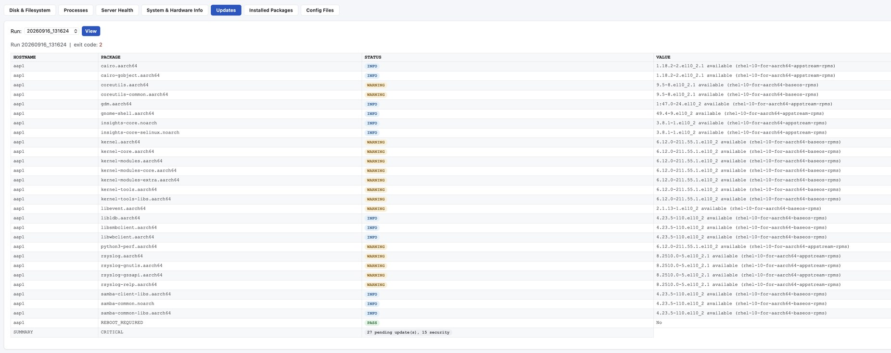
Every pending package update (name, available version/release,
repository), each flagged INFO or WARNING (WARNING for kernel and
other watched packages), plus a one-line summary of total pending
updates and how many are security-relevant — enough to gauge patch
urgency for a host without running `dnf check-update` by hand.

**Installed Packages** — 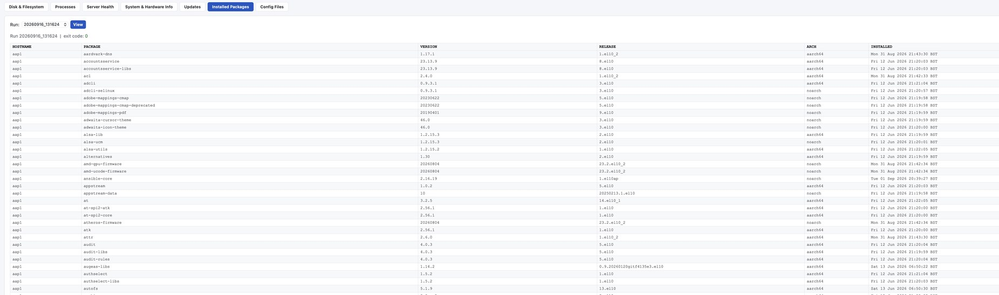
The full installed-package inventory for the host (name, version,
release, architecture, install date) — useful for confirming exactly
what shipped a fix, or diffing package sets between two hosts that are
supposed to be identical.

**Config Files** — 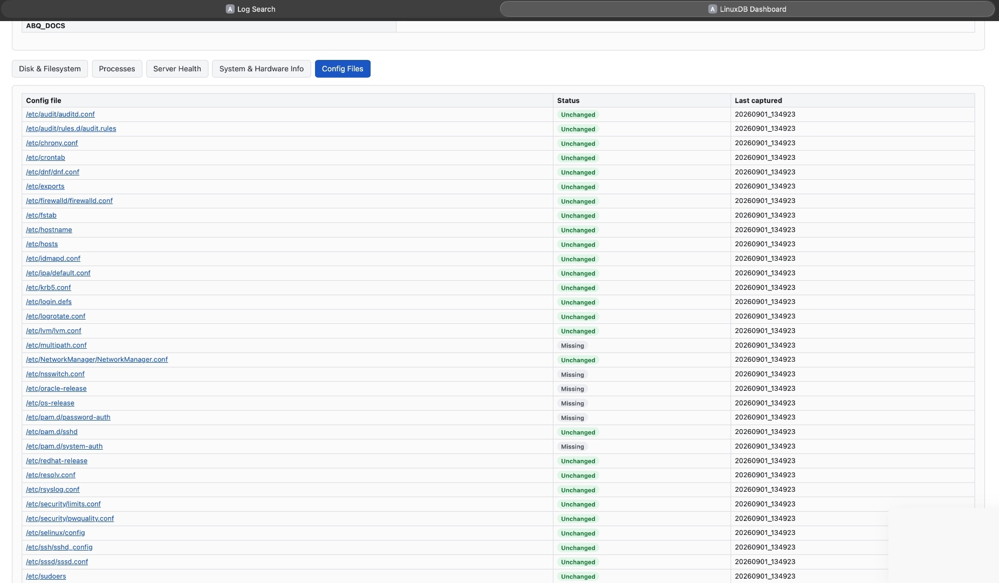
A tracked list of security- and operations-relevant config files
(`/etc/ssh/sshd_config`, `/etc/sudoers`, `/etc/firewalld/firewalld.conf`,
`/etc/krb5.conf`, `/etc/sssd/sssd.conf`, `/etc/audit/*`, PAM stacks,
etc.) each flagged **Unchanged** or **Missing** against the last
captured baseline, with a timestamp and a link through to the file's
actual captured content — a lightweight drift-detection view that
flags "this file used to exist / used to look different" without
needing a full configuration-management diff tool.

## Why this matters for the work rollout

Together these two dashboards turn "SSH into each box and grep/df/ps
by hand across 160+ servers" into two web pages: one for point-in-time
fleet state and per-host drill-down (LinuxDB), one for searching and
spotting patterns across everyone's logs over time (Log Search). Both
are already gated behind sign-in, both are pure-stdlib/BaseOS-only
builds with no new attack surface from third-party packages, and both
are deployed the same way as everything else in this repo — one
Ansible role, one playbook run, no manual server setup.
